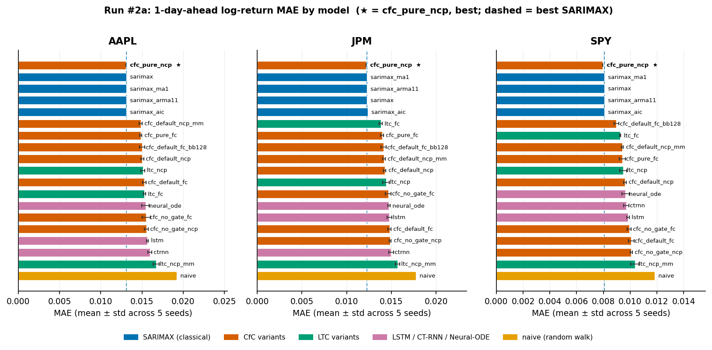
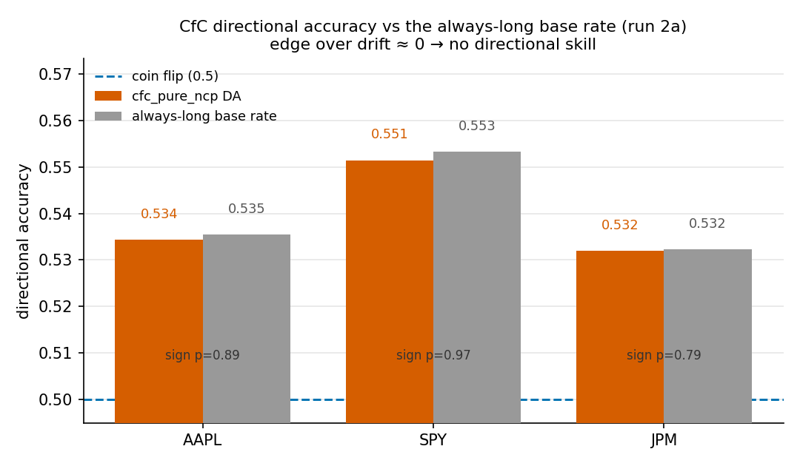

# Liquid Neural Networks vs. Traditional Models

Experiment code for my bachelor's thesis at Leuphana University Lüneburg (B.Sc. Business Informatics, 2026; thesis graded 1.0):
*Liquid Neural Networks vs. Traditional Models: A Comparative Study in Financial Time Series Forecasting.*

**[Read the thesis (PDF, 89 pages)](https://github.com/julschmidtJJL/lnn-vs-classical-forecasting/releases/download/thesis-2026/Schmidt-2026-Liquid-Neural-Networks-vs-Traditional-Models.pdf)**

This repository is a cleaned extract of the private experiment repository (87 commits, March to October 2026). That history stays private because it contains personal notes and configuration.

**Question.** Do liquid neural networks forecast daily financial returns better than classical models?

**Answer.** No. Across 11 liquid variants and 8 baselines on three US assets, **0 of 120 corrected comparisons** show a liquid model significantly beating a traditional baseline.

## Findings

- **No significant edge.** No liquid variant significantly outperforms the traditional baselines on any asset (Diebold–Mariano with small-sample correction, Holm-adjusted).
- **Best model is not a real win.** The best variant, a pure-gated, sparsely wired CfC, topped the point metrics on all three assets. That lead is not significant, and its directional edge is fully explained by market drift.
- **Liquid models do differ from other neural models.** Within the neural field, liquid models separate cleanly and significantly. The measured expressivity (trajectory length) orders the neural field but does not translate into skill against the traditional bar.

The limit is the data, not the model: daily returns carry too little signal for extra capacity to pay off.



*Forecast error (MAE) by model and asset. The best liquid variant (`cfc_pure_ncp`) sits level with the classical ARMA baselines; the difference is not significant.*



*The best model's directional hit rate matches simply always predicting "up". Its apparent edge is market drift, not skill.*

## Quick start

Paste this into Claude Code. It works the same in Codex or Cursor.

```
Clone https://github.com/julschmidtJJL/lnn-vs-classical-forecasting, then read
skills/lnn-benchmark/SKILL.md in it and follow it step by step: install it,
check the headline result against the committed data, and run the quick
end-to-end check. Then help me add <a model or a ticker> under the same
walk-forward and Diebold–Mariano protocol. Do not edit the published results
or figures, never ask me to paste an API key, and stay inside the repository.
```

[`skills/lnn-benchmark/SKILL.md`](skills/lnn-benchmark/SKILL.md) is the whole
procedure, including how a new model or ticker plugs in. By hand, it is three
steps. Requires Python 3.11; everything runs on CPU.

**1. Install and test** (a few minutes to install; the 300 tests take about 4 minutes on a 2020 Intel MacBook):

```bash
git clone https://github.com/julschmidtJJL/lnn-vs-classical-forecasting.git
cd lnn-vs-classical-forecasting
python3.11 -m venv .venv
.venv/bin/pip install -r requirements.txt pytest
.venv/bin/python -m pytest -q tests
```

**2. Check the headline** against the committed result tables behind the figures (seconds, no download, no key):

```bash
.venv/bin/python - <<'PY'
import pandas as pd
dm = pd.read_csv("src/docs/figures/data/dm_cfc_vs_sarimax_audit.csv")
print(f"{int(dm.significant.sum())} of {len(dm)} corrected comparisons significant")
mae = pd.read_csv("src/docs/figures/data/mae_run2a.csv")
print(mae.sort_values(["ticker", "mae_mean"]).groupby("ticker").head(5).to_string(index=False))
PY
```

It prints `0 of 120 corrected comparisons significant` and the five lowest-MAE
models per asset: the best CfC variant, then the four ARMA baselines, within
2% of each other.

**3. Run the pipeline end to end** on fresh data (about 8 minutes on the same laptop).
It needs your own free [FRED API key](https://fred.stlouisfed.org/docs/api/api_key.html):

```bash
cp .env.example .env       # then set FRED_API_KEY and SEC_USER_AGENT in it
```

`SEC_USER_AGENT` is your name and email, which SEC EDGAR asks every caller to
send. The Alpha Vantage, FMP and Finnhub keys in the template are not used.
Results are normally logged to Supabase. Without a Supabase project, set
`SUPABASE_URL=http://127.0.0.1:9` and `SUPABASE_KEY=offline` in `.env`: every
write then fails at once and lands in a local JSONL fallback under
`src/results/logger_fallback/`, and the run carries on. Then:

```bash
cd src && ../.venv/bin/python main.py config.smoke.yaml
```

This is the smoke configuration: AAPL only, 3 walk-forward folds, one seed,
shortened training. It downloads prices, macro series and filings, fits every
model family, runs the DM/Holm tests and writes
`src/results/walk_forward/AAPL_wf_summary.json`. It checks that the pipeline
works; its numbers are not the thesis results.

The full grid (`config.yaml`: 3 assets, 10 years, 19 models, 5 seeds, 50
training epochs per neural model and fold) takes days on a CPU. A `Dockerfile`
and a cloud run guide (`CLOUD_RUN.md`) are included for running it on a rented
Linux VM.

## Setup

| | |
|---|---|
| Assets | AAPL, JPM, SPY, ten years of daily data |
| Target | one-step-ahead log return |
| Evaluation | expanding-window walk-forward: 750-day initial window, 21-day folds |
| Seeds | 5 (42–46); point metrics as mean ± std, significance reported per seed |
| Significance | Diebold–Mariano (Harvey–Leybourne–Newbold correction), Holm adjustment |
| Liquid models (11) | LTC and CfC variants across gating mode, wiring (fully connected / sparse NCP) and memory |
| Baselines (8) | LSTM, CT-RNN, Neural ODE, Naive, four ARMA specifications |
| Inputs | price history (yfinance), macro series (FRED, lagged one day for publication delay), SEC EDGAR fundamentals |

Every run records its provenance (git commit, config, seed, input snapshot hash), so each number in the thesis traces back to the exact code and data that produced it.

## Repository layout

```
src/
  main.py            orchestrator: data → features → walk-forward → models → DM/Holm tests
  config*.yaml       run definitions (config.yaml = main grid, config.smoke.yaml = quick check)
  data_import/       yfinance, FRED and SEC EDGAR loaders
  data_cleaning/     cleaning and stationarity handling
  features/          feature engineering
  models/            ltc, cfc, lstm, ctrnn, neural_ode, naive, sarimax (ARMA), varmax
  evaluation/        metrics, Diebold–Mariano, Holm, Friedman
  analysis/          seed aggregation, expressivity / trajectory-length analysis
  provenance.py      run identity and input snapshots
tests/               pytest suite (33 modules)
skills/              agent procedure the quick-start prompt follows
scripts/             figure builders, data-quality and stationarity checks
src/docs/            methodology and results notes, figures and their data
docs/                validity audit
```

## Limitation worth knowing

The ARMA baselines were fitted without an intercept (the statsmodels SARIMAX default). A refit with an intercept leaves the null result unchanged; the thesis discloses this.

## About this repository

This is a clean snapshot of my private development repository, published without its history. Run provenance in the results (git commit hashes) refers to that private history. The papers I worked from are cited in the thesis, not redistributed here. `vendor/` holds the reference implementations of LTC and CfC by their original authors, under their Apache 2.0 licenses.

## Author

Julius M. Schmidt, Hamburg · [juliusmschmidt.com](https://www.juliusmschmidt.com)
