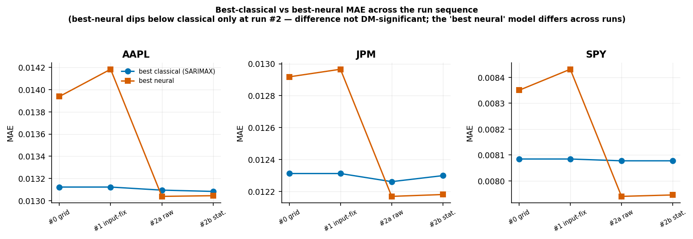
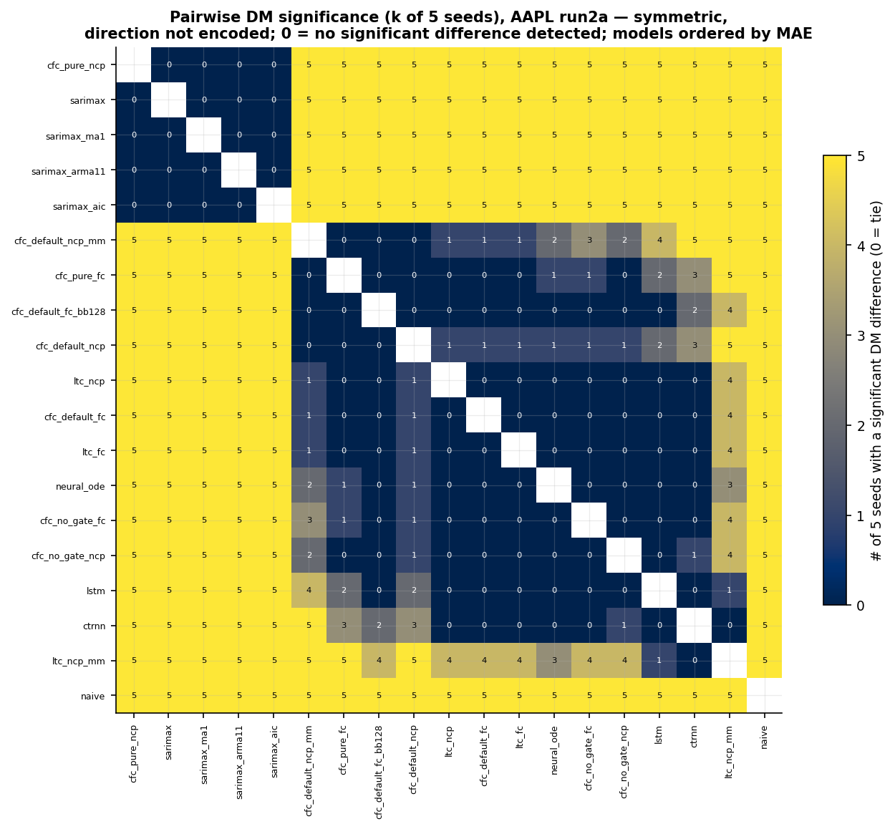

# Results — bullet skeleton (for prose expansion)

*★ = content added 2026-07-06 (post-hoc input-data audit, `src/docs/audit_findings_2026-07-06.md`).*

> Draft skeleton written from the Supabase provenance record + the aggregation
> scripts, to be turned into full prose by the author. Companion to
> `thesis_methodology.md` — same structure convention: **Part A** = headline &
> reading of the whole result, **Part B** = the forecasting runs in sequence
> (each states only its own numbers), **Part C** = the expressivity study,
> **Part D** = robustness / diagnostics / threats to validity.
>
> **Marker legend:**
> - **✅ (Supabase-computed)** — number is aggregated directly from
>   `experiment_summaries` by `analysis.aggregate_seeds` / the figure script; the
>   generating command is named so it regenerates verbatim.
> - **📊 (figure)** — rendered PNG in `src/docs/figures/`, produced by
>   `scripts/build_results_figures.py` (read-only; pulls Supabase, writes PNG+CSV).
> - **⚠️ (caveat)** — a limitation that qualifies the number; cross-referenced to
>   `thesis_methodology.md` Part D.
>
> **A note on statistical language (important for the writeup).** A per-seed
> Diebold–Mariano (DM) test returning "not significant" means we **failed to reject
> the null of equal forecast accuracy** — it is *not* evidence that two models are
> equivalent. Everywhere below, "no significant difference detected" is used
> instead of "tie/indistinguishable/equivalent". Establishing equivalence would
> need an equivalence/non-inferiority test, which was not run. ⚠️
>
> **Everything here is aggregated from Supabase.** Point metrics are mean ± sample-std
> across the 5 seeds (42–46); classical models are seed-invariant so their std is
> 0.00000 (a sanity check). DM tests are Holm-corrected within each seed, reported
> as a "k of 5 seeds significant" distribution (Workstream-C decision, methodology
> A8). ⚠️ The per-seed DM counts are **not** independent replications (see D).
>
> **Reproduce every table & figure:**
> ```
> python -m analysis.aggregate_seeds run2a-20260625      # arm 2a tables
> python -m analysis.aggregate_seeds run2b-20260627      # arm 2b tables
> python scripts/build_results_figures.py                # all figures + CSVs + audit
> python scripts/build_directional_skill_figure.py       # Figure D-DA + directional_skill.csv
> ```
> The appendix tables below are **pasted verbatim** from the script's generated
> `figures/data/appendix_tables.md`, so they cannot drift from the CSVs.

This study ran **four forecasting runs (#0 → #1 → #2a → #2b)** plus a separate
**latent trajectory-length expressivity study**. Run #2 (arms 2a raw / 2b
stationarized exog) is the definitive forecasting experiment; #0 and #1 are
precursor ablations that close validity concerns and establish the classical
baseline is not an artifact of the input pipeline. Coverage is complete: **30/30
(arm × ticker × seed) cells** for run #2, 15/15 each for #0 and #1.

---

# PART A — Headline

- **The result is negative.** Continuous-time / "liquid" networks (LTC, CfC) and
  their neural peers (LSTM, CT-RNN, Neural-ODE) show **no significant advantage**
  over classical AR/SARIMAX at 1-day-ahead log-return forecasting on AAPL, SPY, JPM.
- **One variant reaches the top of the point-metric table, but the difference is
  not significant.** `cfc_pure_ncp` (pure CfC mode, NCP wiring, no gate — a run-#2
  ablation absent in #0/#1) posts the **lowest mean MAE on all three tickers in both
  arms**. ✅
- **No `cfc_pure_ncp`-vs-SARIMAX comparison is significant.** All **120** such DM
  comparisons (4 SARIMAX specs × 3 tickers × 5 seeds × 2 arms) return
  not-significant with `p_corrected = 1.0` (min = 1.0 across all 120). ✅ ⚠️ These
  120 checks are *coverage of every planned pairwise comparison*, not 120
  independent tests — they share assets, the seed-invariant classical forecasts,
  and two correlated arms, so they do not compound into stronger evidence. Audit:
  `figures/data/dm_cfc_vs_sarimax_audit.csv`.
- **The separation it *does* have is internal to the neural field.** `cfc_pure_ncp`
  is DM-significant (5/5 seeds, every ticker/arm) *and* numerically better than every
  other neural model and `naive` — a defensible win there, not over the classical
  baseline. ✅
- **Nobody predicts direction — and the CfC's DA > 0.5 is drift, not skill.**
  Directional accuracy is at chance (≈0.43–0.55) for all models including SARIMAX;
  the MAE separation is a magnitude/calibration effect, not a directional one. ⚠️
  `cfc_pure_ncp` is the one model whose DA sits *above* 0.5 on all three tickers
  (0.534 / 0.551 / 0.532), but that edge is **entirely unconditional drift**: it is
  fractionally *below* the always-long base rate (0.535 / 0.553 / 0.532), and the
  few days it deviates from "always up" lose more often than they win (paired sign
  test p ≈ 0.79–0.97). ✅ See Part D and Figure D-DA. This is an *independent*
  corroboration of the DM null: direction and magnitude both say no edge.
- **Stationarizing the exogenous features has no detectable effect on the headline.**
  Arm 2a → 2b moves the *top model's* MAE by **< 0.1%** on every ticker and reverses
  no ranking. ✅ ⚠️ Some lower-ranked models shift more (e.g. SPY
  `cfc_default_fc_bb128` 0.00897 → 0.00972), so this is "no headline effect", not
  "no effect on any model".

📊 **Figure 1** (`figures/fig1_mae_ranking_run2a.png`) — the whole story in one
panel: per-ticker MAE ranking for run 2a, models colored by family, `cfc_pure_ncp`
(★) at the top edge of the tight SARIMAX cluster (dashed line = best SARIMAX), the
rest of the neural field trailing, `naive` last.


📊 **Figure 2** (`figures/figD_run_progression.png`) — the narrative arc: best
classical vs best neural MAE across the run sequence. Neural is clearly worse in
#0/#1; only at run #2 (once the `cfc_pure_ncp` ablation exists) does the best neural
number dip below classical — and even then the difference is not significant.
⚠️ **Caveat for the caption:** "best neural" is not one model — at #0/#1 it is the
best of cfc/ltc/lstm/ctrnn/neural_ode, at #2 it is `cfc_pure_ncp` (a variant that
did not exist in #0/#1). The crossover is partly the introduction of a new variant,
not the same model improving. Non-zero y-axis; read relative movement only.



---

# PART B — Forecasting results by run

## B1. Run #0 — baseline grid (`grid-2026-06-11`)
- 12 model conditions (cfc/ltc/ctrnn/lstm/neural_ode in raw+transformed, plus
  naive, sarimax), 3 tickers × 5 seeds. ✅
- **SARIMAX strictly lowest MAE on all three tickers** — AAPL 0.01312, JPM 0.01231,
  SPY 0.00808 (`sarimax_transformed`). No neural model is numerically ahead. ✅
- Every model beats `naive` 5/5; neural models are not significantly separated from
  one another (pairwise DM mostly 0/5). Establishes the classical baseline. ⚠️
  superseded as the definitive comparison by run #2 (which adds the CfC ablation grid).

## B2. Run #1 — input-fix ablation (`run1-logreturn-2026-06-18`)
- Same model set as #0; closes the "did the log-return input wiring disadvantage
  the nets" concern. ✅
- **Headline unchanged: SARIMAX still strictly best** — AAPL 0.01312, JPM 0.01231,
  SPY 0.00808, essentially identical to #0. ✅ The input fix does not flip the
  result → the classical win is not a pipeline artifact.

## B3. Run #2a — variant grid, base transforms (`run2a-20260625`)
- **19 model conditions** per (ticker, seed): the full CfC ablation family (pure /
  default / no-gate × NCP / fully-connected wiring, ± mixed-memory, ± bb128
  backbone), LTC family, LSTM, CT-RNN, Neural-ODE, naive, and 4 SARIMAX specs
  (plain, ma1, arma11, AIC-selected). ✅
- **`cfc_pure_ncp` #1 on all three tickers** — AAPL 0.01304, JPM 0.01217,
  SPY 0.00794 — just ahead of the SARIMAX cluster (best SARIMAX AAPL 0.01310 /
  JPM 0.01226 / SPY 0.00808). ✅ Relative gap vs best SARIMAX ≈ 0.4% / 0.7% / 1.7%.
- **DM: `cfc_pure_ncp` vs each SARIMAX spec = 0/5 on every ticker** (no significant
  difference), vs every other neural model and naive = 5/5 (significant). The 4
  SARIMAX specs are not significantly separated from each other (0/5). ✅ Full
  "k of 5" matrix → Appendix Figure A4.
- ⚠️ On SPY only, a second CfC variant (`cfc_default_fc_bb128`, 0.00897) also slots
  into the near-classical range; still not DM-significant vs SARIMAX, does not change
  the headline.
- Full 19-model point-metric table → **Appendix Table 1**.

## B4. Run #2b — + stationarized exogenous features (`run2b-20260627`)
- Identical apparatus to 2a; the only change is exogenous features are made
  stationary before entering the matrix (methodology B4). ✅
- **Every headline number reproduces within < 0.1%** — `cfc_pure_ncp` AAPL 0.01305,
  JPM 0.01218, SPY 0.00795; still #1 on all three; DM result vs SARIMAX still 0/5
  everywhere. ✅
- **No detectable effect on the headline comparison.** Report as a null *for the top
  model / ranking*, not as proof that stationarization is irrelevant. ✅ ⚠️ Two
  reasons to keep the claim narrow: (i) some lower-ranked models do move by a few
  percent between arms (Figure A2 off-diagonal points); (ii) the dead-macro bug
  (Part D) means several macro features were not live, so part of what 2b
  re-stationarizes never entered the model. Frame as "no detectable effect on the
  headline; interpretation limited because several macro features were not live".
- 📊 **Figure A2** (`figures/figB_stationarization_null.png`) — 2a-vs-2b MAE
  scatter; the top models track y = x, a few lower-ranked models sit off it.
- Full 19-model point-metric table → **Appendix Table 2**.

---

# PART C — Latent trajectory-length expressivity study

> Full analysis + method in `expressivity_scale_finding.md` and
> `thesis_methodology.md` Part C. Summarized here; this track is computed offline
> (`analysis.run_expressivity_chapter`), not from the forecasting Supabase tables.

- **Motivation, not cause.** The chapter asks whether Hasani's *theoretical* LNN
  expressivity advantage (latent trajectory length) is even real on financial data
  at random init — i.e. why one might have *expected* a liquid-net win — not why the
  forecast lost.
- **Headline: the LTC trajectory-length dominance is largely a SCALE artifact.**
  Canonical track (AAPL, 25 windows × 10 seeds, k=100): raw arc-length ratios
  LTC/CT-RNN **12.6×**, LTC/Neural-ODE **5.9×**, collapse to scale-invariant
  `L_norm` **≈1.0×** for both. ✅ (from finding doc)
- **Not a finance quirk** — same collapse on Hasani's own synthetic circle
  (raw 13.8× / 8.8× → `L_norm` 1.08× / 1.62×). The order-of-magnitude edge is latent
  *magnitude*, not per-radius geometric complexity.
- **`L_norm` is not a wash-out** — the production ("bench") track keeps real spread:
  CfC 0.32 > LTC 0.27 > CT-RNN 0.22 > LSTM 0.20. Liquid nets retain a modest
  scale-free edge over LSTM. ⚠️ but it does not convert into forecast skill (Part A).
- **Robust to m** (PCA dimensionality): the collapse holds at m=8 (90% variance),
  not just the m=2 shadow. ✅
- ⚠️ Interpretation to carry into prose: expressivity-as-advertised is weaker than
  the headline ratios suggest, which *reframes the expectation* of an LNN win — it
  is not offered as the mechanism of the forecasting loss.

---

# PART D — Robustness, diagnostics & threats to validity

- **DM counts are not independent replications.** The "k of 5 seeds" and the 120
  headline comparisons share assets, the seed-invariant classical forecasts, and two
  correlated arms; treat them as coverage, not compounding evidence. No
  equivalence/non-inferiority test was run, so "no significant difference" is not
  "equivalent". ⚠️
- **Seed-invariance sanity check passes.** `naive` and all `sarimax` show
  ±0.00000 MAE std across seeds; `cfc_pure_ncp` is also ±0.00000 to 5 d.p. ✅
- **Directional accuracy at chance for all** (≈0.43–0.55) — MAE is the only axis of
  separation; do not over-read the point win. ⚠️ The one apparent exception,
  `cfc_pure_ncp`'s DA > 0.5, is dissected below and is **not** a real directional
  signal.

### D-AUDIT. Post-hoc input-data audit (2026-07-06) ★

A full post-hoc audit of the pipeline **and of the frozen training snapshots themselves** (the
parquet frames in `experiment-snapshots` that the models actually trained on; full evidence in
`src/docs/audit_findings_2026-07-06.md`) found four exogenous-input defects: ★

- **SEC duration mixing** — income/cash-flow "quarterly" features mix 3/6/9/12-month XBRL durations
  (AAPL revenue: 81bn → 366bn → 124bn → 221bn; JPM revenue: annual-total ↔ 0 square wave).
  Balance-sheet items are clean. ★
- **FRED staleness tail** — every macro column is a frozen forward-fill over the final ≈7 months of
  every run (fixed download end-date 2025-11-07; last value-change ≤ 2025-11-10 in all groups/tickers);
  in run 2b the differenced macro is exactly 0 there. ★
- **Run 2b missed one series** — a key-sanitization mismatch left `us_real_manufacturing_&_trade_sales`
  at its raw level in the "stationarized-exog" arm (1 of 37 macro series). ★
- **Fundamental coverage** — fundamentals begin ~2021 (last ~20 quarters kept), so ≈50% of the 10-y
  sample carries mean-filled placeholder fundamentals. ★

**Why the headline survives**: all four defects live in the exogenous block; the winning AR(1)/SARIMAX
baseline consumes **no exogenous features**, every model within a run trained on byte-identical
(hash-verified) inputs, and degraded exog can only have *handicapped* the neural models — a bias that
cannot manufacture the "no NN beats AR(1)" null. The honest retreat is interpretive: the networks
received *partially degraded* macro/fundamental information, so "even with exogenous information they
don't win" weakens to "no tested configuration extracted a significant edge under this protocol." ★

**Exog-drop robustness cell** (direct test of that retreat): one cell (AAPL, seed 42), the headline
pair (`sarimax` AR(1), `cfc_pure_ncp`) + naive, run twice on identical folds (n = 85) — once with the
full 492-column feature set (control, `robust-full-20260706`), once with FRED macro and SEC
fundamentals **removed entirely** (32 columns: prices, technicals, indices, past target;
`robust-noexog-20260706`; `scripts/gen_robustness_configs.py`). The treatment arm's pinned input is an
**exact column-subset of the control arm's frame** (target byte-identical by construction; verified
via stored fingerprints), so the contrast is pure feature-set membership, ceteris paribus.
*Note: two independent same-day Yahoo fetches are NOT bit-identical — dividend-adjusted prices wobble
at the ~1e-6 level between API calls (0 target sign-flips; the originally live-built treatment frame
is archived at `robust-noexog-livebuild-20260706/`); the subset design removes even that.*

**Result — the headline is insensitive to the exogenous block (dropping it changes nothing).** Both
arms completed cleanly (85/85 folds each, 0 tracebacks, `exit=0`). Removing all FRED macro + SEC
fundamental columns moves `cfc_pure_ncp`'s mean MAE by **−3 × 10⁻⁶** (0.013030 → 0.013027 — if
anything *marginally better* without the degraded exog), and leaves `naive` and `sarimax` bit-identical
(neither consumes exogenous features by construction). The headline pair stays statistically
indistinguishable in **both** arms — the Diebold–Mariano test for `sarimax` vs `cfc_pure_ncp` is
non-significant with and without exog (control DM = 1.41, p = 0.160; no-exog DM = 1.42, p = 0.154), so
the exogenous defects (SEC duration mixing, FRED staleness) do **not** account for the null. ★

| model | control MAE (`robust-full`) | no-exog MAE (`robust-noexog`) | Δ MAE |
|---|---|---|---|
| `naive_transformed`        | 0.019227 | 0.019227 | 0 |
| `sarimax_transformed` (AR(1)) | 0.013101 | 0.013101 | 0 |
| `cfc_pure_ncp_transformed` | 0.013030 | 0.013027 | −0.000003 |

This closes the interpretive retreat above empirically: the neural model does not merely fail to *win*
with degraded exogenous information — it does not do measurably better when that information is removed
altogether, so the "no tested configuration extracted a significant edge" null is not an artifact of the
audited input defects. ★

### D-DA. The CfC's DA > 0.5 is a base-rate artifact, not directional skill

A natural follow-up to the point win: `cfc_pure_ncp` is the only model with DA
above 0.5 on all three tickers — could it at least be trading-useful directionally?
No. The apparent edge is **entirely unconditional drift**.

- **Method.** For each ticker, pool the model's per-fold 1-step predictions (from
  the `experiment-snapshots` prediction parquets; script asserts all 5 seeds share
  the same dates with identical actuals) and run two tests. **(1) DA vs a coin flip
  (0.5)** — a binomial on one seed's ~1,735 daily directions as independent
  Bernoulli trials (daily 1-step directions are near-uncorrelated). **(2) DA vs
  always-long** — this is a *paired* comparison, not two independent rates: on days
  the CfC also predicts "up" it ties always-long by construction, so only its
  *down-call* days can win or lose. The honest test is therefore a **sign test
  (exact McNemar) on those discordant down-call days** — of them, how many did the
  market actually fall? Reproduced by `scripts/build_directional_skill_figure.py`. ✅
- **vs a coin flip, the edge is significant** — AAPL 0.534 (p=0.002), SPY 0.551
  (p<0.001), JPM 0.532 (p=0.004). Taken alone this looks like a directional signal. ✅
- **vs always-long, the edge is gone — and the deviations hurt.** Always-long base
  rates are AAPL 0.535, SPY 0.553, JPM 0.532 (for these up-drifting series
  always-long is also the best constant-sign rule), so the CfC's DA is *fractionally
  below* each (edge −0.0012 / −0.0018 / −0.0003). Pooled over the 5 seeds it makes
  only 80 / 80 / 25 down-calls, and those win just **44% / 40% / 44%** of the time —
  *below* a coin flip. The paired sign test finds no evidence the down-calls help
  (one-sided p = 0.89 / 0.97 / 0.79); if anything they cost accuracy. The model has
  **no directional skill beyond knowing markets drift up.** ✅
- **Mechanism (the smoking gun).** In a long/short backtest on the predicted sign
  (seed 42, `directional_skill_backtest.csv`), `cfc_pure_ncp` makes **0 sign-flips
  on AAPL and JPM** — it predicts "up" on every test day (a constant) — so the
  strategy is *identical* to buy-and-hold there. On SPY it flips ~0.28×/yr and those
  "down" calls lose money: strategy 0.64 vs 0.99 for buy-and-hold (transformed target
  units). It never beats buy-and-hold gross, and transaction costs only widen the
  gap. ⚠️ Backtest is in the model's transformed target space and shown for seed 42;
  the DA and paired-sign tests pool all 5 seeds (DA is near-identical per seed).
- **Why it matters.** This is an *independent* line of evidence for the headline
  DM null (Part A): once drift is removed, the CfC has neither a magnitude edge (DM
  0/5 vs SARIMAX) nor a directional one (its deviations from always-long lose). The
  two axes agree.

📊 **Figure D-DA** (`figures/figD_directional_skill.png`) — per-ticker `cfc_pure_ncp`
DA (orange) against the always-long base rate (grey), coin-flip 0.5 dashed; the
annotation is the paired sign-test p on the CfC's down-call days (all ≫ 0.05 → no
evidence the deviations from always-long help). The orange bar never clears the grey
one.


- **JPM run-2b has one fewer walk-forward fold** (85 vs 86 → 1615 vs 1634 result
  rows/seed), uniform across all 19 models and 5 seeds — a structural differencing
  drop, not a failure (verified at box audit: 0 tracebacks in the full log). ✅
- **FRED macro release-lag lookahead** ⚠️ — monthly macro series indexed by
  reference date with a 1-day shift, not the real ~2–6 week release lag.
  Documented-by-design and *conservative*: AR(1) uses no exog, and the nets receive
  the mildly-leaked macro and still lose. (methodology D)
- **FRED frequency-inference bug** ⚠️ — CPI, Core CPI, unemployment, LFP were nulled
  in #0/#1/#2, so the nets never saw them. Headline unaffected; but it undercuts the
  run-2b framing (see B4).
- **Arm-2b confound & seed order-dependence** ⚠️ — see methodology D; not re-run
  (fresh run #2, both arms share the same run-list order).
- **`merge_dm` is a confirmatory no-op** — run #2 runs lstm/ctrnn/neural_ode in-run,
  so `merge_dm` (which would bolt run #1's neural baselines onto run #2) drops them
  as duplicate `run_key`s (`merge_dm.py:178-189`) and reproduces run #2's own DM.
  The authoritative tables are the `aggregate_seeds` outputs. ✅

---

# Appendix

## Appendix figures
- 📊 **Figure A1** — run 2b MAE ranking by model (`figures/figA_mae_ranking_run2b.png`).
- 📊 **Figure A2** — stationarization 2a-vs-2b scatter (`figures/figB_stationarization_null.png`).
- 📊 **Figure A3** — `cfc_pure_ncp` vs best SARIMAX bars, both arms, with the 0/5 DM annotation (`figures/fig2_cfc_vs_sarimax_tie.png`).
- 📊 **Figure A4** — pairwise DM significance heatmap, AAPL run 2a (symmetric; direction not encoded; 0 = no significant difference). The top-left 5×5 all-zero block (`cfc_pure_ncp` + 4 SARIMAX) is the not-significant cluster (`figures/figC_dm_heatmap_aapl_run2a.png`).



## Data extracts (machine-readable, regenerated by `scripts/build_results_figures.py`)
- `figures/data/mae_run2a.csv`, `figures/data/mae_run2b.csv` — per (ticker, model)
  mean MAE, std, DA.
- `figures/data/appendix_tables.md` — the source of Appendix Tables 1 & 2 below.
- `figures/data/dm_cfc_vs_sarimax_audit.csv` — every `cfc_pure_ncp`-vs-SARIMAX DM
  comparison with its `p_corrected` and significance flag (grounds the 0/120 claim).
- `figures/data/directional_skill.csv` — per-ticker `cfc_pure_ncp` DA, always-long
  base rate, the DA-vs-coin-flip binomial p, and the paired sign-test on down-call
  days (count, win-rate, p); source of Figure D-DA.
- `figures/data/directional_skill_backtest.csv` — seed-42 long/short-vs-buy-and-hold
  gross returns and sign-flips/yr (grounds the Part D-DA backtest numbers). Both
  regenerated by `scripts/build_directional_skill_figure.py`.

<!-- Appendix Tables 1 & 2 are pasted verbatim from figures/data/appendix_tables.md. -->

## Appendix Table 1 — Run 2a (raw exog), MAE mean ± std across 5 seeds

Lowest MAE per ticker in **bold**; DA = mean directional accuracy. Rows sorted by (MAE, model name) — identical to the CSV.

| Ticker | Model condition        | MAE                   | DA    |
|--------|------------------------|-----------------------|-------|
| AAPL   | **cfc_pure_ncp**       | **0.01304 ± 0.00000** | 0.513 |
| AAPL   | sarimax                | 0.01310 ± 0.00000     | 0.471 |
| AAPL   | sarimax_arma11         | 0.01310 ± 0.00000     | 0.478 |
| AAPL   | sarimax_ma1            | 0.01310 ± 0.00000     | 0.487 |
| AAPL   | sarimax_aic            | 0.01311 ± 0.00000     | 0.432 |
| AAPL   | cfc_default_ncp_mm     | 0.01485 ± 0.00019     | 0.481 |
| AAPL   | cfc_pure_fc            | 0.01485 ± 0.00012     | 0.485 |
| AAPL   | cfc_default_fc_bb128   | 0.01502 ± 0.00031     | 0.488 |
| AAPL   | cfc_default_ncp        | 0.01503 ± 0.00018     | 0.479 |
| AAPL   | ltc_ncp                | 0.01510 ± 0.00022     | 0.490 |
| AAPL   | cfc_default_fc         | 0.01527 ± 0.00021     | 0.488 |
| AAPL   | ltc_fc                 | 0.01531 ± 0.00015     | 0.487 |
| AAPL   | neural_ode             | 0.01543 ± 0.00045     | 0.481 |
| AAPL   | cfc_no_gate_fc         | 0.01550 ± 0.00050     | 0.485 |
| AAPL   | cfc_no_gate_ncp        | 0.01553 ± 0.00024     | 0.485 |
| AAPL   | lstm                   | 0.01564 ± 0.00011     | 0.484 |
| AAPL   | ctrnn                  | 0.01596 ± 0.00025     | 0.476 |
| AAPL   | ltc_ncp_mm             | 0.01674 ± 0.00037     | 0.478 |
| AAPL   | naive                  | 0.01921 ± 0.00000     | 0.452 |
| JPM    | **cfc_pure_ncp**       | **0.01217 ± 0.00000** | 0.511 |
| JPM    | sarimax_ma1            | 0.01226 ± 0.00000     | 0.472 |
| JPM    | sarimax                | 0.01229 ± 0.00000     | 0.458 |
| JPM    | sarimax_arma11         | 0.01229 ± 0.00000     | 0.478 |
| JPM    | sarimax_aic            | 0.01236 ± 0.00000     | 0.452 |
| JPM    | ltc_fc                 | 0.01383 ± 0.00017     | 0.496 |
| JPM    | cfc_pure_fc            | 0.01396 ± 0.00018     | 0.491 |
| JPM    | cfc_default_fc_bb128   | 0.01413 ± 0.00030     | 0.493 |
| JPM    | cfc_default_ncp_mm     | 0.01418 ± 0.00013     | 0.484 |
| JPM    | cfc_default_ncp        | 0.01426 ± 0.00012     | 0.487 |
| JPM    | ltc_ncp                | 0.01440 ± 0.00039     | 0.494 |
| JPM    | cfc_no_gate_fc         | 0.01464 ± 0.00030     | 0.481 |
| JPM    | neural_ode             | 0.01473 ± 0.00014     | 0.487 |
| JPM    | lstm                   | 0.01478 ± 0.00026     | 0.488 |
| JPM    | cfc_default_fc         | 0.01479 ± 0.00017     | 0.492 |
| JPM    | cfc_no_gate_ncp        | 0.01486 ± 0.00012     | 0.490 |
| JPM    | ctrnn                  | 0.01498 ± 0.00028     | 0.476 |
| JPM    | ltc_ncp_mm             | 0.01569 ± 0.00025     | 0.483 |
| JPM    | naive                  | 0.01773 ± 0.00000     | 0.470 |
| SPY    | **cfc_pure_ncp**       | **0.00794 ± 0.00000** | 0.530 |
| SPY    | sarimax                | 0.00808 ± 0.00000     | 0.467 |
| SPY    | sarimax_arma11         | 0.00808 ± 0.00000     | 0.485 |
| SPY    | sarimax_ma1            | 0.00808 ± 0.00000     | 0.475 |
| SPY    | sarimax_aic            | 0.00809 ± 0.00000     | 0.490 |
| SPY    | cfc_default_fc_bb128   | 0.00897 ± 0.00018     | 0.491 |
| SPY    | ltc_fc                 | 0.00925 ± 0.00004     | 0.483 |
| SPY    | cfc_default_ncp_mm     | 0.00941 ± 0.00007     | 0.485 |
| SPY    | cfc_pure_fc            | 0.00942 ± 0.00022     | 0.487 |
| SPY    | ltc_ncp                | 0.00949 ± 0.00026     | 0.490 |
| SPY    | cfc_default_ncp        | 0.00962 ± 0.00009     | 0.491 |
| SPY    | neural_ode             | 0.00966 ± 0.00027     | 0.486 |
| SPY    | ctrnn                  | 0.00971 ± 0.00020     | 0.491 |
| SPY    | lstm                   | 0.00984 ± 0.00010     | 0.481 |
| SPY    | cfc_no_gate_fc         | 0.00993 ± 0.00014     | 0.485 |
| SPY    | cfc_default_fc         | 0.01009 ± 0.00020     | 0.487 |
| SPY    | cfc_no_gate_ncp        | 0.01009 ± 0.00010     | 0.484 |
| SPY    | ltc_ncp_mm             | 0.01036 ± 0.00032     | 0.479 |
| SPY    | naive                  | 0.01185 ± 0.00000     | 0.458 |

## Appendix Table 2 — Run 2b (stationarized exog), MAE mean ± std across 5 seeds

Lowest MAE per ticker in **bold**; DA = mean directional accuracy. Rows sorted by (MAE, model name) — identical to the CSV.

| Ticker | Model condition        | MAE                   | DA    |
|--------|------------------------|-----------------------|-------|
| AAPL   | **cfc_pure_ncp**       | **0.01305 ± 0.00000** | 0.513 |
| AAPL   | sarimax_aic            | 0.01308 ± 0.00000     | 0.431 |
| AAPL   | sarimax                | 0.01310 ± 0.00000     | 0.472 |
| AAPL   | sarimax_arma11         | 0.01311 ± 0.00000     | 0.478 |
| AAPL   | sarimax_ma1            | 0.01311 ± 0.00000     | 0.487 |
| AAPL   | cfc_pure_fc            | 0.01467 ± 0.00024     | 0.488 |
| AAPL   | cfc_default_ncp_mm     | 0.01499 ± 0.00010     | 0.481 |
| AAPL   | cfc_default_ncp        | 0.01505 ± 0.00017     | 0.483 |
| AAPL   | cfc_default_fc_bb128   | 0.01521 ± 0.00027     | 0.486 |
| AAPL   | ltc_fc                 | 0.01526 ± 0.00012     | 0.488 |
| AAPL   | neural_ode             | 0.01541 ± 0.00042     | 0.478 |
| AAPL   | ctrnn                  | 0.01559 ± 0.00037     | 0.485 |
| AAPL   | cfc_no_gate_ncp        | 0.01560 ± 0.00007     | 0.488 |
| AAPL   | cfc_default_fc         | 0.01561 ± 0.00017     | 0.479 |
| AAPL   | cfc_no_gate_fc         | 0.01572 ± 0.00028     | 0.490 |
| AAPL   | ltc_ncp                | 0.01597 ± 0.00016     | 0.482 |
| AAPL   | lstm                   | 0.01605 ± 0.00009     | 0.485 |
| AAPL   | ltc_ncp_mm             | 0.01730 ± 0.00071     | 0.484 |
| AAPL   | naive                  | 0.01922 ± 0.00000     | 0.452 |
| JPM    | **cfc_pure_ncp**       | **0.01218 ± 0.00000** | 0.511 |
| JPM    | sarimax_ma1            | 0.01230 ± 0.00000     | 0.469 |
| JPM    | sarimax                | 0.01233 ± 0.00000     | 0.460 |
| JPM    | sarimax_arma11         | 0.01233 ± 0.00000     | 0.477 |
| JPM    | sarimax_aic            | 0.01237 ± 0.00000     | 0.452 |
| JPM    | cfc_pure_fc            | 0.01379 ± 0.00023     | 0.491 |
| JPM    | cfc_default_fc_bb128   | 0.01382 ± 0.00024     | 0.485 |
| JPM    | ltc_fc                 | 0.01396 ± 0.00006     | 0.488 |
| JPM    | ltc_ncp                | 0.01407 ± 0.00015     | 0.493 |
| JPM    | cfc_default_ncp_mm     | 0.01411 ± 0.00019     | 0.485 |
| JPM    | cfc_default_ncp        | 0.01429 ± 0.00008     | 0.493 |
| JPM    | cfc_default_fc         | 0.01452 ± 0.00022     | 0.490 |
| JPM    | cfc_no_gate_fc         | 0.01454 ± 0.00026     | 0.495 |
| JPM    | ctrnn                  | 0.01474 ± 0.00034     | 0.490 |
| JPM    | neural_ode             | 0.01476 ± 0.00042     | 0.490 |
| JPM    | cfc_no_gate_ncp        | 0.01481 ± 0.00021     | 0.487 |
| JPM    | lstm                   | 0.01495 ± 0.00011     | 0.481 |
| JPM    | ltc_ncp_mm             | 0.01548 ± 0.00038     | 0.488 |
| JPM    | naive                  | 0.01771 ± 0.00000     | 0.473 |
| SPY    | **cfc_pure_ncp**       | **0.00795 ± 0.00000** | 0.531 |
| SPY    | sarimax                | 0.00808 ± 0.00000     | 0.468 |
| SPY    | sarimax_arma11         | 0.00808 ± 0.00000     | 0.487 |
| SPY    | sarimax_ma1            | 0.00808 ± 0.00000     | 0.475 |
| SPY    | sarimax_aic            | 0.00810 ± 0.00000     | 0.491 |
| SPY    | ltc_ncp                | 0.00932 ± 0.00005     | 0.480 |
| SPY    | ltc_fc                 | 0.00955 ± 0.00007     | 0.482 |
| SPY    | cfc_default_ncp_mm     | 0.00969 ± 0.00018     | 0.488 |
| SPY    | cfc_default_fc_bb128   | 0.00972 ± 0.00030     | 0.488 |
| SPY    | cfc_pure_fc            | 0.00982 ± 0.00021     | 0.487 |
| SPY    | cfc_default_ncp        | 0.00988 ± 0.00013     | 0.487 |
| SPY    | neural_ode             | 0.00995 ± 0.00020     | 0.482 |
| SPY    | cfc_no_gate_ncp        | 0.01030 ± 0.00020     | 0.493 |
| SPY    | ctrnn                  | 0.01034 ± 0.00023     | 0.483 |
| SPY    | lstm                   | 0.01034 ± 0.00014     | 0.480 |
| SPY    | cfc_no_gate_fc         | 0.01042 ± 0.00009     | 0.481 |
| SPY    | ltc_ncp_mm             | 0.01053 ± 0.00010     | 0.482 |
| SPY    | cfc_default_fc         | 0.01061 ± 0.00015     | 0.481 |
| SPY    | naive                  | 0.01185 ± 0.00000     | 0.458 |

## Appendix Table 3 — DM significance summary (`cfc_pure_ncp` vs the field)

"k/5" = number of the 5 seeds with a significant Holm-corrected DM difference; 0/5
means no significant difference was detected (not equivalence — see Part D).

| Comparison | Result | Reading |
|------------|--------|---------|
| `cfc_pure_ncp` vs each SARIMAX spec | **0/5 every ticker, both arms (0 of 120, min p_corrected 1.0)** | no significant difference detected — the headline |
| `cfc_pure_ncp` vs every other neural model | 5/5 all tickers/arms | significant, and numerically better |
| `cfc_pure_ncp` vs `naive` | 5/5 | significantly better than random walk |
| each SARIMAX vs `naive` | 5/5 | classical significantly better than random walk |
| SARIMAX spec vs SARIMAX spec | 0/5 | the 4 specs not significantly separated |
